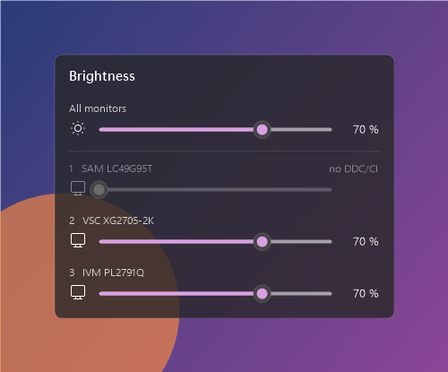

# Monitor Brightness Flyout

[](https://github.com/stonymahomie/monitor-brightness-flyout/releases/latest)
[](https://github.com/stonymahomie/monitor-brightness-flyout/releases)


[](https://claude.com/claude-code)

A tiny Windows tray app that controls the brightness of **each external monitor individually**, with a flyout that looks and feels like the Windows 11 quick settings.

Windows only has a brightness slider for built-in laptop screens. This tool talks to external monitors directly over the display cable using **DDC/CI**, so no on-screen-display buttons are needed.

<p align="center"></p>

## Features

- **Tray icon + Windows 11 style flyout:** rounded corners, translucent blurred background, slide-in animation and sliders in your Windows accent color
- **One slider per monitor** plus an "All monitors" slider; mouse wheel adjusts by ±2 %
- **Command line** for scripts, hotkeys and scheduled tasks
- **Start with Windows** from the tray menu
- **UI language follows Windows** (English, or German on German systems)
- **Zero dependencies:** a single ~35 KB `.exe`, built with the C# compiler that ships with Windows

## Download

Grab `BrightnessFlyout.exe` from the [latest release](https://github.com/stonymahomie/monitor-brightness-flyout/releases/latest) and run it. Nothing to install.

> The `.exe` is not code-signed, so Windows SmartScreen may warn on first launch. Click **More info → Run anyway**, or build it yourself (see below).

## Usage

Run `BrightnessFlyout.exe`. A sun icon appears in the notification area (on Windows 11 it may start hidden under the `^` arrow; drag it onto the taskbar to keep it visible).

| Action | Result |
|---|---|
| Left click on the icon | Open the flyout with the sliders |
| Mouse wheel over a slider | ±2 % |
| `Esc` or click outside | Close the flyout |
| Right click on the icon | All to 100/75/50/25 %, re-detect monitors, start with Windows, exit |

Launching the `.exe` again while it runs just opens the flyout of the running instance.

### Command line

```
BrightnessFlyout.exe list        show monitors and current brightness
BrightnessFlyout.exe 2 50        set monitor 2 to 50 %
BrightnessFlyout.exe all 30      set all monitors to 30 %
BrightnessFlyout.exe 3 +10       monitor 3 10 % brighter (-10 = darker)
```

Monitors are numbered from left to right.

## Requirements and limitations

- **DDC/CI must be enabled in the monitor's on-screen menu.** Monitors without it show up as "no DDC/CI" with a locked slider.
- Some docking stations, adapters and KVM switches don't pass DDC/CI through.
- DDC/CI is slow (about 50–100 ms per command), so a value is only sent once a slider rests for a moment.
- Built-in laptop screens are not supported (they don't use DDC/CI).
- Monitors plugged in while the app runs need **Re-detect monitors** from the tray menu.

## Building

Only needs Windows with .NET Framework 4.x (included in Windows 10 and 11):

```
build.cmd
```

This calls the built-in compiler (`%WINDIR%\Microsoft.NET\Framework64\v4.0.30319\csc.exe`), which only supports C# 5, so the code avoids `$"…"` strings and `?.`.

`BrightnessFlyout.exe --render preview.png [en-US]` saves the flyout as an image, handy for checking the look without opening it.

## How it works

- **Brightness:** `dxva2.dll` (`GetMonitorBrightness` / `SetMonitorBrightness`), the Windows API for DDC/CI
- **Monitor names:** EDID data via WMI (`WmiMonitorID`)
- **Flyout:** drawn entirely with GDI+ into a layered window (`UpdateLayeredWindow`), blur via `SetWindowCompositionAttribute`, accent color from `AccentPalette`
- **Autostart:** `HKCU\Software\Microsoft\Windows\CurrentVersion\Run`, value `BrightnessFlyout`

## Built with Claude

Most of the work on this project was done by **[Claude](https://www.anthropic.com/claude)**, Anthropic's AI model, in [Claude Code](https://claude.com/claude-code): the code, the Windows 11 flyout design, the debugging and this README.

[stonymahomie](https://github.com/stonymahomie) had the idea, tested everything on a real three-monitor setup and steered the design.
